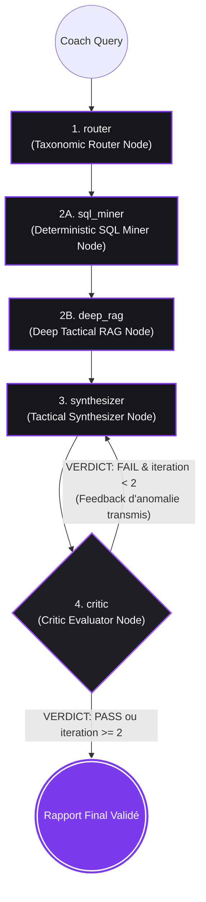

# Module A : Orchestration Agentique & Machine à États avec LangGraph

> **Composant :** Orchestration Multi-Agents, Machine à États Dirigée (DAG) et Auto-Correction Réflexive (Critic LLM-as-a-Judge).  
> **Tech Stack :** LangGraph, LangChain, SQLite, Pydantic v2, Groq LPU, OpenAI, Gemini.

---

## 1. Vision Architecturale & Pourquoi LangGraph ?

Dans les applications métier à haute exigence, une simple chaîne séquentielle (*Linear Chain*) échoue car elle ne permet ni retour en arrière, ni isolation des responsabilités, ni audit contradictoire. 

`foot-GPT` modélise le processus d'analyse tactique sous la forme d'un **graphe à états finis dirigé (StateGraph)** articulé autour de **4 nœuds spécialisés** avec gestionnaire d'état typé et boucle conditionnelle d'auto-correction.



---

## 2. Contrat d'État Centralisé (`TacticalAgentState`)

L'état global de l'agent est défini dans `src/schemas/state.py`. Il garantit un typage strict et utilise un reducer d'accumulation pour la télémétrie :

```python
def merge_telemetry(old: Optional[Dict[str, Any]], new: Optional[Dict[str, Any]]) -> Dict[str, Any]:
    """Reducer pour fusionner proprement la télémétrie produite par chaque nœud."""
    merged = dict(old or {})
    if new:
        merged.update(new)
    return merged

class TacticalAgentState(TypedDict):
    # 1. Entrées de session
    coach_query: str
    match_id: int
    thread_id: str
    user_time_range: Optional[Tuple[int, int]]
    
    # 2. Sorties d'étapes (Pydantic models)
    tactical_plan: Optional[TacticalPlan]
    match_facts: Optional[MatchFacts]
    retrieved_chunks: Optional[List[Dict[str, Any]]]
    draft_report: Optional[str]
    critic_verdict: Optional[VerificationVerdict]
    critic_feedback: Optional[str]
    iteration_count: int
    
    # 3. Rapport Final & Télémétrie
    final_report: Optional[str]
    execution_telemetry: Annotated[Optional[Dict[str, Any]], merge_telemetry]
```

---

## 3. Décomposition des 4 Nœuds du Graphe

### Nœud 1 : Taxonomic Router Node (`src/agent/nodes/router_node.py`)
- **Rôle :** Analyse l'intention du coach et produit un schéma Pydantic `TacticalPlan`.
- **Typologies gérées :** `DIAGNOSTIC_SEQUENCE` (analyse micro d'une tranche de jeu), `MACRO_MATCH_FLOW` (analyse globale du match complet), `PLAYER_IMPACT` (impact individuel), `TACTICAL_COMPARISON` (comparaison d'équipes/périodes).
- **Résolution dynamique d'entités :** Extrait les équipes autorisées et les joueurs directement depuis la base SQL via `MatchMiner().get_match_metadata(match_id)`, éliminant tout hardcoding.

### Nœud 2A : Deterministic SQL Miner Node (`src/agent/nodes/sql_miner_node.py`)
- **Rôle :** Calcule les indicateurs spatio-temporels exacts sur SQLite en mode lecture seule (`mode=ro`).
- **Feature Engineering spatial :** Polygones de la Zone 14 ($x \in [75, 95], y \in [30, 50]$), des demi-espaces ($y \in [18, 30] \cup [50, 62]$), du tiers offensif ($x \ge 80$), des pertes sous pression et des récupérations hautes.
- **Calcul des baselines :** Mesure les écarts statistiques relatifs (deltas vs baseline moyenne du match).
- **Suivi des statuts de jeu :** Trace la chronologie exacte des remplacements et le temps de jeu effectif des joueurs.
- **Sortie :** Schéma Pydantic `MatchFacts` (source de vérité mathématique indiscutable).

### Nœud 2B : Deep Tactical RAG Node (`src/agent/nodes/deep_rag_node.py`)
- **Rôle :** Exécute la recherche documentaire hybride `HybridRetriever` et retourne les 4 chunks théoriques les plus pertinents avec leurs métadonnées de citation.

### Nœud 3 : Tactical Synthesizer Node (`src/agent/nodes/synthesizer_node.py`)
- **Rôle :** Rédige le rapport tactique en respectant la norme d'or UEFA Pro :
  1. *Partie 1 : Diagnostic Factuel* (volumes, xG, Zone 14, deltas).
  2. *Partie 2 : Principes Tactiques & Ancrage Théorique* (citations formelles `[Auteur, Année - Titre]`).
  3. *Partie 3 : Prescriptions de 2 Séances d'Entraînement* (dimensions au mètre, 6v4, consignes posturales, critères de réussite).
- **Contraintes strictes :** 0 préambule conversationnel, 0 émoji, filtrage des tokens de réflexion `<think>`.

### Nœud 4 : Critic Evaluator Node (`src/agent/nodes/critic_node.py`)
- **Rôle :** **LLM-as-a-Judge** automatisé.
- **Audit :** Vérifie ligne par ligne que chaque chiffre du texte correspond au JSON brut `MatchFacts` et que chaque principe théorique est appuyé par une citation réelle.
- **Sortie Pydantic :** `VerificationVerdict` (`is_faithful`, `faithfulness_score`, `is_fully_cited`, `citation_coverage_score`, `anomalies`, `verdict: PASS | FAIL`).
- **Comportement Fail-Closed :** En cas d'erreur de parsing ou de timeout, émet un `FAIL` sécurisé (`faithfulness_score: 0.0`) pour empêcher toute acceptation silencieuse.

---

## 4. Principes de Conception

1. **Suppression de l'hallucination par le design d'état :** Le LLM de synthèse ne fait jamais de calcul. Les faits sont injectés de façon déterministe depuis SQLite et audités par le Critic.
2. **Contrôle de flux conditionnel :** Si le Critic rejette le draft, le graphe réitère automatiquement avec les consignes de correction transmises au Synthesizer (limité à 2 itérations).
3. **Résilience et Tolérance aux Pannes :** LLM Factory avec bascule automatique entre Groq, OpenAI et Gemini en cas de limitation de taux HTTP 429.
4. **Roadmap v2 :** Parallélisation asynchrone (`sql_miner` et `deep_rag` en parallèle) et fine-tuning de SLMs 3B pour le Router et le Critic.
