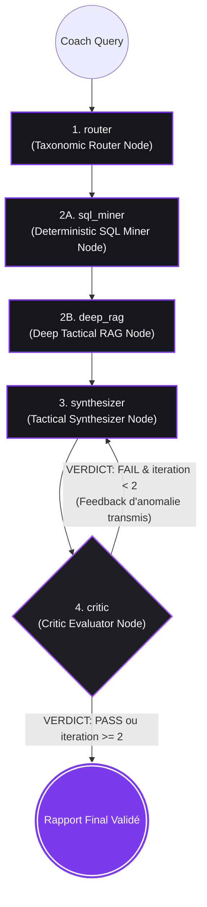

# Module A : Orchestration Agentique & Machine à États avec LangGraph

> **Composant :** Orchestration Multi-Agents, Machine à États Dirigée (DAG) et Auto-Correction Réflexive (Critic LLM-as-a-Judge).  
> **Tech Stack :** LangGraph, LangChain, SQLite, Pydantic v2, Groq LPU, OpenAI, Gemini.

---

## 1. Vision Architecturale & Pourquoi LangGraph ?

Dans les applications métier à haute exigence, une simple chaîne séquentielle (*Linear Chain*) échoue car elle ne permet ni retour en arrière, ni isolation des responsabilités, ni audit contradictoire. 

`foot-GPT` modélise le processus d'analyse tactique sous la forme d'un **graphe à états finis dirigé (StateGraph)** articulé autour de **5 nœuds spécialisés** (router, sql_miner, deep_rag, synthesizer, critic) avec gestionnaire d'état typé et boucle conditionnelle d'auto-correction.



---

## 2. Contrat d'État Centralisé (`TacticalAgentState`)

L'état global de l'agent est défini dans `src/schemas/state.py`. Il garantit un typage strict et utilise un reducer d'accumulation pour la télémétrie :

```python
def merge_telemetry(old: Optional[Dict[str, Any]], new: Optional[Dict[str, Any]]) -> Dict[str, Any]:
    """Reducer pour fusionner proprement la télémétrie produite par chaque nœud."""
    merged = dict(old or {})
    if new:
        merged.update(new)
    return merged

class TacticalAgentState(TypedDict):
    # 1. Entrées de session
    coach_query: str
    match_id: int
    thread_id: str
    user_time_range: Optional[Tuple[int, int]]
    
    # 2. Sorties d'étapes (Pydantic models)
    tactical_plan: Optional[TacticalPlan]
    match_facts: Optional[MatchFacts]
    retrieved_chunks: Optional[List[Dict[str, Any]]]
    sources_sufficient: Optional[bool]   # False si aucun chunk n'atteint RERANK_MIN_SCORE
    draft_report: Optional[str]
    critic_verdict: Optional[VerificationVerdict]
    critic_feedback: Optional[str]
    iteration_count: int
    
    # 3. Champs déclarés mais non utilisés par le graphe actuel
    is_human_approved: bool
    analyst_modifications: Optional[str]

    # 4. Rapport Final & Télémétrie
    final_report: Optional[str]
    execution_telemetry: Annotated[Optional[Dict[str, Any]], merge_telemetry]
```

---

## 3. Décomposition des 5 Nœuds du Graphe

### Nœud 1 : Taxonomic Router Node (`src/agent/nodes/router_node.py`)
- **Rôle :** Analyse l'intention du coach et produit un schéma Pydantic `TacticalPlan`.
- **Typologies gérées :** `DIAGNOSTIC_SEQUENCE` (analyse micro d'une tranche de jeu), `MACRO_MATCH_FLOW` (analyse globale du match complet), `PLAYER_IMPACT` (impact individuel), `TACTICAL_COMPARISON` (comparaison d'équipes/périodes).
- **Résolution dynamique d'entités :** Extrait les équipes autorisées et les joueurs directement depuis la base SQL via `MatchMiner().get_match_metadata(match_id)`, éliminant tout hardcoding.

### Nœud 2A : Deterministic SQL Miner Node (`src/agent/nodes/sql_miner_node.py`)
- **Rôle :** Calcule les indicateurs spatio-temporels exacts sur SQLite en mode lecture seule (`mode=ro`).
- **Feature Engineering spatial :** Polygones de la Zone 14 ($x \in [75, 95], y \in [30, 50]$), des demi-espaces ($y \in [18, 30] \cup [50, 62]$), du tiers offensif ($x \ge 80$), des pertes sous pression et des récupérations hautes.
- **Calcul des baselines :** Mesure les écarts statistiques relatifs (deltas vs baseline moyenne du match).
- **Suivi des statuts de jeu :** Trace la chronologie exacte des remplacements et le temps de jeu effectif des joueurs.
- **Sortie :** Schéma Pydantic `MatchFacts` (source de vérité mathématique indiscutable).

### Nœud 2B : Deep Tactical RAG Node (`src/agent/nodes/deep_rag_node.py`)
- **Rôle :** Construit la requête enrichie (`build_enriched_query` : question + thèmes + zones + 2 clés de deltas), exécute la recherche hybride `HybridRetriever` et retourne **jusqu'à 4** chunks théoriques avec leurs métadonnées de citation.
- **Filtre de pertinence :** les chunks dont le score de re-ranking est inférieur à `RERANK_MIN_SCORE` (`src/config.py`) sont écartés. Si aucun ne passe, `sources_sufficient=False` et le synthétiseur ne reçoit aucun extrait.
- Détail du pipeline : [PIPELINE_RAG_HYBRIDE.md](PIPELINE_RAG_HYBRIDE.md).

### Nœud 3 : Tactical Synthesizer Node (`src/agent/nodes/synthesizer_node.py`)
- **Rôle :** Rédige le rapport tactique en respectant la norme d'or UEFA Pro :
  1. *Partie 1 : Diagnostic Factuel* (volumes, xG, Zone 14, deltas).
  2. *Partie 2 : Principes Tactiques & Ancrage Théorique* : jusqu'à 2 principes, uniquement s'ils sont soutenus par les extraits fournis, chacun avec sa citation exacte `[Auteur, Année - Titre]`. Si les sources sont insuffisantes, le rapport l'indique explicitement au lieu de citer.
  3. *Partie 3 : Prescriptions de 2 Séances d'Entraînement* (dimensions au mètre, 6v4, consignes posturales, critères de réussite).
- **Contraintes strictes :** 0 préambule conversationnel, 0 émoji, filtrage des tokens de réflexion `<think>`.

### Nœud 4 : Critic Evaluator Node (`src/agent/nodes/critic_node.py`)
- **Rôle :** **LLM-as-a-Judge** automatisé.
- **Audit par le LLM :** vérifie que les chiffres du texte correspondent au JSON brut `MatchFacts` (fidélité, équipes, remplacements, phases) et que chaque principe est ancré dans un fait du match (`is_anchored`).
- **Audit par le code :** toute citation `[Auteur, Année - Titre]` du rapport doit correspondre (après normalisation) à l'un des extraits réellement fournis ; sinon anomalie `invalid_citation` et FAIL forcé (`src/rag/citations.py`). Un rapport non ancré ne peut pas être PASS.
- **Sortie Pydantic :** `VerificationVerdict` (`is_faithful`, `faithfulness_score`, `is_fully_cited`, `is_anchored`, `citation_coverage_score`, `anomalies`, `verdict: PASS | FAIL`).
- **Limite :** la fidélité numérique reste jugée par un LLM ; aucun contrôle programmatique des chiffres.
- **Comportement Fail-Closed :** En cas d'erreur de parsing ou de timeout, émet un `FAIL` sécurisé (`faithfulness_score: 0.0`) pour empêcher toute acceptation silencieuse.

---

## 4. Principes de Conception

1. **Réduction des hallucinations par le design d'état :** Le LLM de synthèse ne calcule pas : les faits sont injectés de façon déterministe depuis SQLite, puis audités par le Critic (LLM pour les chiffres, code pour les citations). Cela réduit le risque, sans le supprimer.
2. **Contrôle de flux conditionnel :** Si le Critic rejette le draft, le graphe réitère automatiquement avec les consignes de correction transmises au Synthesizer (limité à 2 itérations).
3. **Résilience :** `LLMFactory` choisit le fournisseur via `LLM_PROVIDER` (Groq par défaut, OpenAI, Gemini, Ollama) et, sur Groq, bascule du modèle principal vers `openai/gpt-oss-120b` en cas d'erreur. Sans clé valide, elle renvoie un `MockChatModel` sans avertissement.
4. **Séquence volontaire :** `deep_rag` dépend de `sql_miner` (les clés de deltas entrent dans la requête RAG) ; ils ne sont donc pas parallélisables sans changer la requête.
5. **Roadmap v2 :** fine-tuning de SLMs 3B pour le Router et le Critic (voir [GUIDE_LATENCE_TOKENS_LLMOPS.md](GUIDE_LATENCE_TOKENS_LLMOPS.md)).
