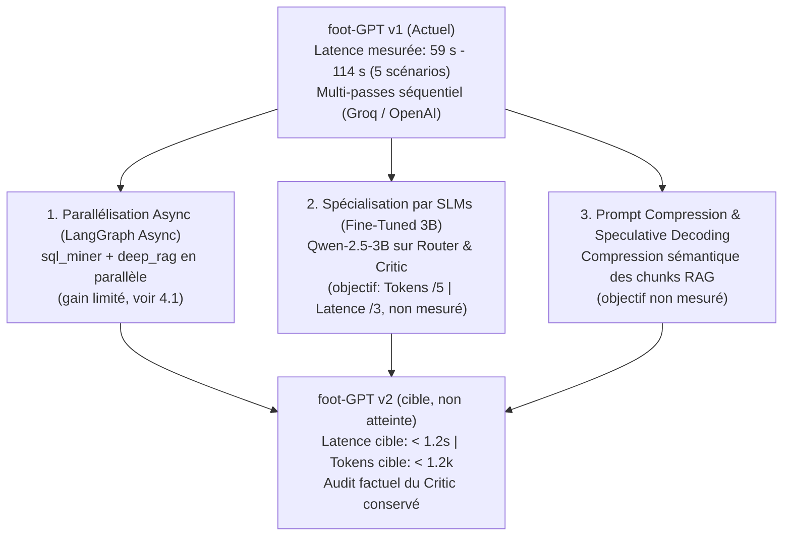

# Guide d'Ingénierie LLMOps : Arbitrage Latence, Tokens & Roadmap v2

> **Sujet :** Gestion de la latence, optimisation des tokens, observabilité et roadmap de production.

---

## 1. Arbitrage d'Architecture : Précision vs Latence (*Engineering Trade-off*)

Une exécution complète du graphe enchaîne trois appels LLM (routeur, synthèse, critique, plus une relance éventuelle). Sur les 5 scénarios de `benchmark_results.json` (Groq, version antérieure du pipeline), la latence mesurée va de **58,6 s à 114,2 s**, avec une seule itération du critique à chaque fois. Les chiffres de tokens ne sont pas mesurés dans le dépôt (estimation : quelques milliers de tokens par run). Ce coût est un **choix d'architecture assumé** : dans le football professionnel, une hallucination statistique est rédhibitoire pour un staff technique. foot-GPT privilégie donc la précision factuelle (audit des chiffres cités par un Critic LLM-as-a-Judge) plutôt que la rapidité brute d'un appel unique.

### ROI Métier :
- **Sans foot-GPT :** hypothèse de travail de 15 à 25 heures par semaine d'extraction SQL/Python manuelle et de rédaction (estimation, non mesurée).
- **Avec foot-GPT :** de l'ordre de la minute de traitement automatisé (voir ci-dessus), avec audit factuel des chiffres cités par le Critic.

---

## 2. Observabilité & Mesure Granulaire (*Show, Don't Tell*)

Plutôt que de traiter le système comme une boîte noire, `foot-GPT` intègre un système d'observabilité granulaire qui mesure le coût et la latence de chaque nœud du graphe.

### 2.1 Tracing par Reducer d'État (`merge_telemetry`)
L'état LangGraph (`TacticalAgentState`) accumule les métriques d'exécution sans écrasement de contexte :

```python
# Clés de télémétrie réellement écrites par les nœuds (valeurs illustratives) :
{
    "router_latency_ms": 240.5,       # Parsing Pydantic & Intent Classification
    "sql_miner_latency_ms": 42.1,     # Calcul déterministe SQLite (Zone 14, xG, Deltas)
    "deep_rag_latency_ms": 110.8,     # Double retrieval (BM25 + ChromaDB + RRF + Cross-Encoder)
    "rag_enriched_query": "...",      # Requête envoyée aux retrievers et au cross-encoder
    "rag_top_rerank_score": -1.2,     # Meilleur score de re-ranking (à comparer à RERANK_MIN_SCORE)
    "rag_chunks_below_threshold": 0,  # Chunks écartés par le filtre de pertinence
    "rag_relevance_filter_active": True,
    "synthesizer_latency_ms": 2450.0, # Génération du rapport en 3 volets UEFA Pro
    "critic_latency_ms": 1120.3,      # Audit LLM-as-a-Judge + contrôle des citations
    "critic_invalid_citations": 0,    # Citations du rapport absentes des extraits fournis
    "total_pipeline_latency_ms": 3963.7  # Somme des latences des nœuds (hors cache)
}
```

### 2.2 Observabilité UI (Dashboard Administration)
Le panneau d'administration (`src/ui/components/admin_dashboard.py`) permet à l'ingénieur de surveiller :
- La distribution de latence par nœud.
- Le ratio de *Cache Hit / Cache Miss*.
- Les requêtes SQL exécutées en temps réel.

---

## 3. La Réponse Technique Immédiate : Caching Multi-Niveaux

Pour neutraliser le coût et la latence sur les requêtes récurrentes, l'architecture déploie 3 niveaux de cache :

1. **Cache Sémantique Vectoriel (`src/cache/semantic_cache.py`) :**
   - Embeddings locaux `FastEmbed` (`BAAI/bge-small-en-v1.5`) avec Cosine Similarity $\ge 0.93$.
   - Clé composite `(query_embedding, match_id, user_time_range)` évitant la contamination entre tranches temporelles.
   - **Performance mesurée :** un hit prend environ 2,5 à 3 ms une fois le modèle chargé (le premier appel charge le modèle, ~240 ms) et ne consomme aucun token. La latence affichée est mesurée avec `perf_counter`.
   - **Limites :** le cache est en mémoire du processus (perdu au redémarrage, sans expiration). `app.py` recharge le module à chaque exécution du script Streamlit, ce qui recrée un cache vide : en pratique les hits sont rares (voir [ARCHITECTURE_VUE_ENSEMBLE.md](ARCHITECTURE_VUE_ENSEMBLE.md), §10). Un rapport servi par le cache s'affiche sans panneau de citations.
2. **Cache de Segmentation Tactique (`MatchPhaseGenerator`) :**
   - Sauvegarde JSON (`data/cached_phases.json`) des découpages en 4-5 phases générés par le LLM.
   - **Performance :** Chargement de la structure du match en **$< 1\text{ ms}$**.
3. **Cache Applicatif UI (`@st.cache_data`) :**
   - Mise en cache mémoire Streamlit des fixtures et métadonnées SQLite.

---

## 4. Vision Production : La Roadmap d'Optimisation v2

Pour faire évoluer foot-GPT vers une utilisation en direct au bord du terrain (SLA $< 1\text{ s}$), la roadmap d'ingénierie définit 3 leviers majeurs :



### 4.1 Axe 1 : Parallélisation Asynchrone (LangGraph Async)
- **Le levier :** Dans le graphe actuel, `sql_miner` (Nœud 2A) et `deep_rag` (Nœud 2B) s'exécutent en séquence.
- **Gain à relativiser :** `sql_miner` et `deep_rag` pèsent quelques dizaines de millisecondes, contre plusieurs dizaines de secondes pour les appels LLM ; le retrieval lui-même ne dure que ~5 ms. Le « -30 % » initialement annoncé n'est pas mesuré.
- **Contrainte de conception :** la requête RAG utilise les clés de deltas calculées par `sql_miner` (Data-Informed). Paralléliser obligerait à retirer ces clés de la requête, ce qui changerait la qualité du retrieval. Le levier réel de latence est le nombre et la taille des appels LLM.

### 4.2 Axe 2 : Spécialisation par Modèles Légers (Fine-Tuned SLMs 3B)
- **Le levier :** Utiliser des grands modèles généralistes (ex: 27B ou 120B) pour le Router ou le Critic est surdimensionné.
- **La solution v2 :** Fine-tuner un Small Language Model (SLM, ex: `Qwen-2.5-3B` ou `Llama-3.2-3B`) via LoRA sur le dataset de validation.
- **Bénéfice visé (non mesuré) :** réduction de la latence par 3 et division par 5 du coût token sur les étapes de cadrage et d'audit.

### 4.3 Axe 3 : Prompt Compression & Speculative Decoding
- **Le levier :** les chunks sont désormais transmis en entier au synthétiseur et au critique (≤ 247 tokens chacun) ; le contexte théorique du synthétiseur fait ~835 tokens en moyenne, et celui du critique ~820.
- **La solution v2 :** une compression sémantique des chunks (LLMLingua ou extraction de phrases clés) ne viserait donc qu'une part limitée du prompt ; elle réduirait aussi le texte sur lequel le critique vérifie les citations. Gain à mesurer avant de l'annoncer.
