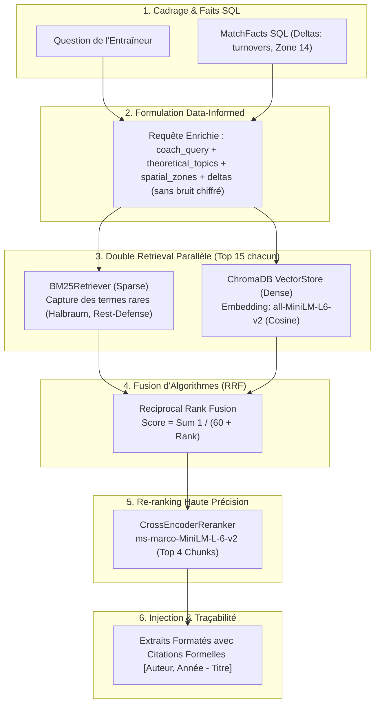

# Module B : Pipeline RAG Hybride Avancé & Ingestion Documentaire

> **Composant :** Recherche Documentaire Hybride (Dense + Sparse), Reciprocal Rank Fusion (RRF), Cross-Encoder Re-ranking et Grounding Réflexif.  
> **Tech Stack :** ChromaDB, BM25 (`rank_bm25`), SentenceTransformers, PyPDF, FastEmbed.

---

## 1. Vision Architecturale & Pourquoi le RAG Naïf Échoue ?

Dans les domaines d'expertise pointue (tactique sportive, finance, juridique), le RAG naïf (*Vector Search + Embedding standard*) échoue sur deux aspects :
1. **La perte du vocabulaire technique rare :** Les termes spécifiques (ex: *Halbraum*, *Rest-Defense*, *Cover Shadow*) sont souvent dilués dans les espaces vectoriels denses.
2. **Le syndrome de la théorie désincarnée :** Le modèle récite de la théorie générale sans être capable de la relier aux faits chiffrés réels du contexte utilisateur.

`foot-GPT` résout ces deux problèmes via une architecture **RAG Hybride Data-Informed à 5 étapes** :

---

## 2. Le Corpus Documentaire Hétérogène (305 Chunks)

Le corpus indexé (`index_knowledge_base.py`) rassemble 3 catégories de sources documentaires expertes :

1. **8 Papiers Scientifiques PDF (`data/research_papers/`) :**
   - Études évaluées par des pairs sur les réseaux de passes, la théorie des graphes et la modélisation spatiotemporelle (*Bauer 2026*, *Brefeld 2019*, *Buldu 2018*, *D'Andrea 2025*, *Decroos 2020*, *Pena 2012*, *Rijsdijk 2025*, *Zhang 2024*).
   - Parsing automatique via `PDFParser` avec extraction de l'index de métadonnées (`papers_metadata_index.json`).
2. **3 Guides Méthodologiques de Haut Niveau (`data/high_level_guides/`) :**
   - Les 4 phases fondamentales de jeu, l'animation des blocs défensifs et la périodisation tactique.
3. **10 Articles Théoriques Spielverlagerung (`data/raw_markdown/`) :**
   - Concepts avancés : *The Half-Spaces*, *Rest-Defense*, *Compactness*, *Counterpressing*, *Juego de Posición*, *Blind Side Potential*.

---

## 3. Innovations d'Ingénierie du Pipeline RAG

### 3.1 Data-Informed Query Formulation (`src/agent/nodes/deep_rag_node.py`)
Au lieu d'envoyer la simple question brute du coach au retriever, le nœud RAG construit une requête sémantique enrichie par les anomalies réelles calculées par le moteur SQL :
- Extraction des concepts théoriques du plan (`theoretical_topics`).
- Extraction des zones spatiales clés (`spatial_zones`).
- Extraction des anomalies statistiques (`significant_deltas`) en retirant le bruit chiffré brut (`+328%` devient `"turnovers under pressure"`).

### 3.2 Double Retrieval & Fusion RRF ($k=60$)
- **Sparse Search (BM25) :** `BM25Retriever` extrait les 15 meilleurs chunks lexicaux.
- **Dense Search (ChromaDB) :** `VectorStoreManager` extrait les 15 meilleurs chunks vectoriels (`all-MiniLM-L6-v2`).
- **Reciprocal Rank Fusion :** L'algorithme standard RRF ($k=60$) fusionne les deux classements sans biais d'échelle :
  $$\text{Score RRF}(d) = \sum_{m \in \{\text{BM25}, \text{Dense}\}} \frac{1}{60 + \text{Rank}_m(d)}$$

### 3.3 Re-ranking Haute Précision par Cross-Encoder
Les 30 candidats fusionnés sont soumis au modèle Cross-Encoder `cross-encoder/ms-marco-MiniLM-L-6-v2` (`src/rag/reranker.py`). Contrairement aux bi-encoders (embeddings cosinus), le Cross-Encoder calcule l'attention croisée token par token entre la requête et le document, maximisant la densité d'information des 4 chunks finaux injectés au LLM.

### 3.4 La « Golden Anchoring Rule » (Grounding Vérifiable)
Le prompt système impose une règle formelle d'ancrage :
> **Chaque principe théorique rédigé DOIT débuter par un fait statistique chiffré du match avant d'exposer la théorie et de citer formellement la publication source `[Auteur, Année - Titre]`.**

---

## 4. Benchmark Comparatif : Gemini 3.7 Extended vs foot-GPT

| Critère de Recherche & Fidélité | Gemini 3.7 Extended (Zero-Shot) | foot-GPT (Data-Informed Hybrid RAG) |
| :--- | :--- | :--- |
| **Précision des Statistiques** | Hallucination totale : invente *562 passes* | Exactitude mathématique : **420 passes** (SQL Ground Truth) |
| **Traçabilité des Sources** | Généralités sans source ni auteur | Citations formelles : `[Spielverlagerung, 2014]`, `[Bauer et al., 2026]` |
| **Couverture Lexicale Pointue** | Ignore les concepts comme *Halbraum* | Capture exacte via le double retrieval BM25 + ChromaDB |
| **Score Faithfulness** | `0.00` | **`0.95 - 1.00`** |
