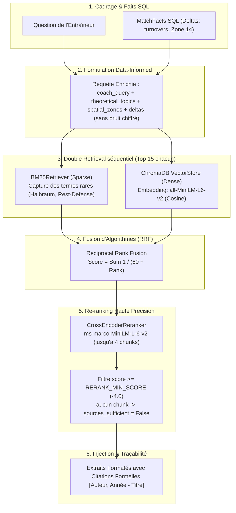

# Module B : Pipeline RAG Hybride Avancé & Ingestion Documentaire

> **Composant :** Recherche Documentaire Hybride (Dense + Sparse), Reciprocal Rank Fusion (RRF), Cross-Encoder Re-ranking et Grounding Réflexif.  
> **Tech Stack :** ChromaDB, BM25 (`rank_bm25`), SentenceTransformers (embedding et cross-encoder), PyPDF. Langue : anglais uniquement (questions et corpus).
> **Mesures et limites :** [eval/RAPPORT_CORRECTIONS.md](eval/RAPPORT_CORRECTIONS.md).

---

## 1. Vision Architecturale & Pourquoi le RAG Naïf Échoue ?

Dans les domaines d'expertise pointue (tactique sportive, finance, juridique), le RAG naïf (*Vector Search + Embedding standard*) échoue sur deux aspects :
1. **La perte du vocabulaire technique rare :** Les termes spécifiques (ex: *Halbraum*, *Rest-Defense*, *Cover Shadow*) sont souvent dilués dans les espaces vectoriels denses.
2. **Le syndrome de la théorie désincarnée :** Le modèle récite de la théorie générale sans être capable de la relier aux faits chiffrés réels du contexte utilisateur.

`foot-GPT` résout ces deux problèmes via une architecture **RAG Hybride Data-Informed** (requête enrichie, double retrieval, fusion RRF, re-ranking, filtre de pertinence) :

---

## 2. Le Corpus Documentaire Hétérogène (977 Chunks)

Le corpus indexé (`index_knowledge_base.py`) rassemble 3 catégories de sources documentaires expertes, toutes en anglais. Répartition des 977 chunks : 521 issus des papiers, 443 des articles Spielverlagerung, 13 des guides.

1. **8 Papiers Scientifiques PDF (`data/research_papers/`) :**
   - Études évaluées par des pairs sur les réseaux de passes, la théorie des graphes et la modélisation spatiotemporelle (*Bauer 2026*, *Brefeld 2019*, *Buldu 2018*, *D'Andrea 2025*, *Decroos 2020*, *Pena 2012*, *Rijsdijk 2025*, *Zhang 2024*).
   - Parsing automatique via `PDFParser` avec extraction de l'index de métadonnées (`papers_metadata_index.json`).
2. **3 Guides Méthodologiques de Haut Niveau (`data/high_level_guides/`) :**
   - Les 4 phases fondamentales de jeu, l'animation des blocs défensifs et la périodisation tactique.
   - Rédigés en interne (auteur « foot-GPT Technical Staff », `year: 2026` dans le frontmatter) : ils ne sont pas des sources académiques.
3. **10 Articles Théoriques Spielverlagerung (`data/raw_markdown/`) :**
   - Concepts avancés : *The Half-Spaces*, *Rest-Defense*, *Compactness*, *Counterpressing*, *Juego de Posición*, *Blind Side Potential*.

### 2.1 Chunking et texte embeddé

- **Unité :** tokens du tokenizer de `all-MiniLM-L6-v2` (et non des mots). Cible de 220 tokens de contenu, recouvrement de 40 tokens (phrases entières), paramètres dans `src/config.py`.
- **Structure d'abord :** les paragraphes (PDF : page par page ; Markdown : section par section) sont conservés entiers quand ils tiennent ; sinon découpage par phrases, puis par mots en dernier recours.
- **Fenêtre de l'embedding :** le texte embeddé est `titre - section` + contenu, et ne dépasse jamais 256 tokens ([CLS]/[SEP] compris), limite du modèle. Le titre et la section figurent aussi dans l'index BM25 et dans l'entrée du reranker.
- **Résultat mesuré :** médiane de 203 tokens, maximum 247, 0 % de chunks tronqués par l'embedding (contre 85 % avant correction).

---

## 3. Innovations d'Ingénierie du Pipeline RAG

### 3.1 Data-Informed Query Formulation (`src/agent/nodes/deep_rag_node.py`)
Au lieu d'envoyer la simple question brute du coach au retriever, le nœud RAG construit une requête sémantique enrichie par les anomalies réelles calculées par le moteur SQL :
- Extraction des concepts théoriques du plan (`theoretical_topics`).
- Extraction des zones spatiales clés (`spatial_zones`).
- Extraction des 2 premières clés de `significant_deltas` (toutes de la forme `Équipe_turnovers_début_fin`), sans leur valeur chiffrée : la requête contient par exemple `Argentina turnovers 0 40 France turnovers 0 40`.
- La même requête est envoyée à BM25, au dense et au cross-encoder. Ces clés abaissent les scores du cross-encoder, ce qui a motivé la calibration du seuil (3.3).

### 3.2 Double Retrieval & Fusion RRF ($k=60$)
- Les deux recherches s'exécutent l'une après l'autre : mesuré, BM25 (~1,2 ms) + dense (~3,8 ms) = 5,0 ms contre 5,1 ms en parallèle, soit aucun gain.
- **Sparse Search (BM25) :** `BM25Retriever` extrait les 15 meilleurs chunks lexicaux.
- **Dense Search (ChromaDB) :** `VectorStoreManager` extrait les 15 meilleurs chunks vectoriels (`all-MiniLM-L6-v2`).
- **Reciprocal Rank Fusion :** L'algorithme standard RRF ($k=60$) fusionne les deux classements sans biais d'échelle :
  $$\text{Score RRF}(d) = \sum_{m \in \{\text{BM25}, \text{Dense}\}} \frac{1}{60 + \text{Rank}_m(d)}$$

### 3.3 Re-ranking Haute Précision par Cross-Encoder
Les candidats fusionnés (jusqu'à 30) sont soumis au modèle Cross-Encoder `cross-encoder/ms-marco-MiniLM-L-6-v2` (`src/rag/reranker.py`). Contrairement aux bi-encoders (embeddings cosinus), le Cross-Encoder calcule l'attention croisée token par token entre la requête et le document, sélectionnant les 4 meilleurs chunks.

**Filtre de pertinence.** Les chunks dont le score est inférieur à `RERANK_MIN_SCORE` (-4.0, logit du cross-encoder) sont écartés ; si aucun ne reste, `sources_sufficient=False`, le synthétiseur ne reçoit aucune source et le rapport doit l'indiquer au lieu de citer. Le seuil est calibré sur 18 requêtes de la forme réelle du pipeline : les 12 en corpus gardent leurs sources, 5 requêtes hors corpus sur 6 sont écartées. Un hors sujet auquel le routeur ajoute des thèmes de football n'est pas détectable (voir le rapport, section 4). Le filtre est désactivé si le cross-encoder n'est pas chargé.

### 3.4 La « Golden Anchoring Rule » (Grounding Vérifiable)
Le prompt système impose une règle formelle d'ancrage :
> **Chaque principe théorique rédigé DOIT débuter par un fait statistique chiffré du match avant d'exposer la théorie et de citer formellement la publication source `[Auteur, Année - Titre]`.**

Le synthétiseur produit jusqu'à 2 principes, uniquement s'ils sont soutenus par les extraits fournis. Le critique vérifie ensuite par code que chaque citation du rapport correspond à un extrait réellement fourni (`src/rag/citations.py`) ; un FAIL est forcé sinon. Cette vérification est de niveau document : elle ne prouve pas que l'extrait soutient l'affirmation, ce que juge encore le LLM.

---

## 4. Benchmark Comparatif : Gemini 3.7 Extended vs foot-GPT

> Comparaison ponctuelle sur une ancienne version du pipeline (`benchmark_results.json`, 5 scénarios), non rejouée depuis les corrections RAG. Les lignes ci-dessous sont indicatives.

| Critère de Recherche & Fidélité | Gemini 3.7 Extended (Zero-Shot) | foot-GPT (Data-Informed Hybrid RAG) |
| :--- | :--- | :--- |
| **Précision des Statistiques** | Hallucination totale : invente *562 passes* | Exactitude mathématique : **420 passes** (SQL Ground Truth) |
| **Traçabilité des Sources** | Généralités sans source ni auteur | Citations formelles, par ex. `[Spielverlagerung Editorial Staff, 2014 - The Half-Spaces]` |
| **Couverture Lexicale Pointue** | Ignore les concepts comme *Halbraum* | Capture exacte via le double retrieval BM25 + ChromaDB |
